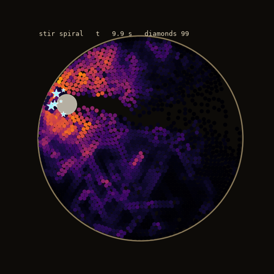
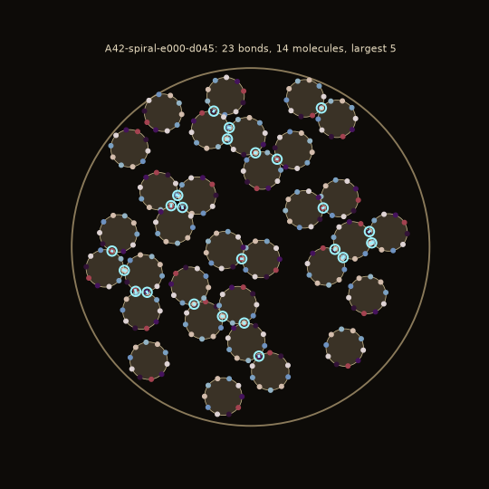

# The particle maker (Aurelia v0)

A bowl of identical-looking rice grains is stirred. The friction between the grains forms *diamonds*:
new artificial particles that come from nowhere but the grains' hidden values and the history of how
they rubbed. Each diamond is a particle species. Copies of a species are dropped into a world of
their own, where they move, turn and bind to each other into molecules. The question v0 asks is
whether the matter they assemble into computes anything useful.

 

*Left: the spoon's spiral path heats the grains by friction (colour); the stars are diamonds forming.
Right: 32 copies of particle `A42-spiral-e000-d045` after assembling; the cyan rings are bonds.*
(`docs/bowl.gif` and `docs/assembly.gif` show them moving.)

```
python -m particle_maker run --minutes 2 --stir spiral --seed 42   # stir, form, test, keep, repeat
python -m particle_maker vault list                                 # kept particles, best first
python -m particle_maker vault show <id>                            # report, definition, provenance
python -m particle_maker vault replay <id>                          # rebuild from seed and re-test
python -m particle_maker bowl --stir all --seconds 20               # friction and diamonds per stir pattern
python -m particle_maker viz --stir spiral                          # docs/bowl.gif
python -m particle_maker viz --particle <id>                        # docs/assembly.gif
```

Python 3.11, NumPy, PyTorch with CUDA (RTX 4070), matplotlib. Set up with
`uv venv --python 3.11 .venv` and `pip install -r requirements.txt` (torch from the cu124 index).
MNIST is read from `AURELIA_MNIST` (default `C:\Users\joose\Neuras\data\mnist`).

## 1. The bowl (`particle_maker/bowl.py`)

- 2000 soft discs of radius 1 fill 78 % of a circular bowl. Every grain has the same physics
  (spring-dashpot contact, Coulomb friction with a viscous cap, air drag) and its own hidden value,
  12 random floats that the physics never reads.
- Stirring: `circle`, `spiral` (the spoon spirals in and out and reverses every 12 s), `figure8`,
  `shake` (the bowl sloshes), `jolt` (random kicks to patches of grains), `mixed`, `none`.
- Friction power per contact = |friction force| x |slip speed|. Each grain keeps a decaying heat
  (tau 1 s), each pair a decaying friction work (tau 2 s) and the time their latest contact began.
- **A diamond forms** when the hottest grain (heat >= 15) seeds a cluster: the grains that rubbed
  hardest against the cluster join (each at least 30 % as hard as its strongest pair), 4 to 12
  of them, and their summed heat reaches 80. Their hidden values, pair work, contact order, peak
  forces and the local stir state become the diamond's *record*. The grains are spent: heat and
  memory to zero, new hidden values.

Stirring measurably makes diamonds (`python -m particle_maker bowl --stir all --seconds 20 --seed 1`):

| stir    | friction work | diamonds |
|---------|--------------:|---------:|
| none    |             0 |        0 |
| jolt    |        23 930 |        3 |
| circle  |        43 903 |       74 |
| figure8 |        44 036 |       72 |
| spiral  |        83 769 |      188 |
| shake   |       115 875 |      142 |
| mixed   |       112 035 |      203 |

The simulation uses a neighbour table rebuilt every 10 steps and only ordered, non-atomic GPU
operations (~2 ms per step), so an episode replays bit for bit.

## 2. The diamond: a particle (`particle_maker/diamond.py`, `particle_maker/particle.py`)

Friction is stick-slip, so the particle is built from stick-slip. A particle has:

- **k ports** on its rim, one per grain, in the order the grains' contacts began. Each port:
  - is a *play operator*: it holds a position and moves only when the drive on it leaves its dead
    zone tau (from the grain's hidden value and how hard it was pressed). It is dragged along at
    distance tau, so it remembers;
  - has a **charge**, a 4-dim unit vector from the grain's hidden value. Two ports attract when their
    charges point opposite ways and repel when they point the same way.
- **an inner structure** A: how a push on one port moves the others. It comes from the friction
  work between the grains, signed by whether their hidden values agree, and directed by contact
  order: a port feels a port that touched earlier fully and a later one by beta, the cluster's swirl.
  A swirling cluster gives a two-way knot, a jolted one a one-way cascade.
- **a mass** (1 + its friction heat / 80) and **a radius** (0.8 + 0.12 k);
- **a slip rate** (from how fast the cluster moved) and **a number of sweeps** (2..6, from how
  unevenly the forces were spread).

Why this form: nothing in it is borrowed from standard ML. Its nonlinearity is a dead zone with
memory (hysteresis), its wiring is what the grains' friction left, and how it connects to other
particles is not designed but decided by charges and shapes when copies collide.

**The world.** 32 copies of a species start at random in a disc covering 35 % of it and move under
their ports' forces, soft body contact and Brownian kicks that cool to zero over 1500 steps. Ports
of different particles that end up touching, with positive affinity, each other's nearest partner,
become bonds. Bonds join particles into molecules (typically 0.5-2 bonds per particle, the largest
molecule 3-9 particles).

**The matter computes.** Inputs push the ports of a quarter of the particles. Each step every port
relaxes for its sweeps through the inner structures and the bonds; nothing in the matter is trained.
Only a linear readout of all port states is fitted (ridge regression).

Every particle is stored as JSON: the record, the definition built from it, their hashes, and its
provenance (run seed, episode seed, step). `vault replay` checks all of it (see 5).

## 3. Testing (`particle_maker/matter.py`)

Five fixed tasks, each drawn once from a fixed data seed:

| task    | what is read off the matter                                                  | score         |
|---------|-------------------------------------------------------------------------------|---------------|
| memcap  | the input 1..15 steps ago (memory capacity)                                    | sum R^2 / 15  |
| xor     | XOR of the two previous random bits                                            | accuracy      |
| narma10 | the NARMA-10 nonlinear system                                                  | R^2           |
| latch   | 4 bits shown once at a random step among noise, recalled at step 10            | bit accuracy  |
| mnist14 | MNIST pooled to 14x14, fed row by row (2000 train, 1000 test)                  | accuracy      |

Comparisons, with the same readout and the same number of units (32 k):

- **ESN** (echo state network, the standard random reservoir), with input scale and spectral radius
  tuned per task on the test score over a 3 x 3 grid, 3 seeds. The matter gets the same input-scale
  grid. Both are tuned on the test set, so both numbers are optimistic in the same way.
- **no bonds**: the same particles unassembled. **random bonds**: the same number of bonds placed at
  random. These say whether the *assembly* matters.
- **scrambled species** (once per run): the first batch's species rebuilt with their friction
  structure shuffled. This says whether the *bowl* matters.

A particle is **kept** when its matter beats or matches the ESN (within max(std, 0.01)) on at least
one task while being clearly above chance (by 0.05). "Assembly matters" marks tasks where it also
beats both bond controls by 0.01. Each particle gets 2 worlds (seeds).

## 4. Results of the first session (2 minutes, spiral, seed 42)

64 particles tested at ~40 per minute; the vault holds all 64 (`vault/`), and
`runs/run-20261106-190156-spiral-s42/` has the log and summary. The 30-minute run was not done.

Mean over the 64 particles, and the ESN of the same size:

| task    | matter | best particle | no bonds | random bonds | ESN   | kept on it | assembly matters |
|---------|-------:|--------------:|---------:|-------------:|------:|-----------:|-----------------:|
| memcap  | 0.102  | 0.134         | 0.100    | 0.102        | 0.999 | 0          | 0                |
| xor     | 0.564  | 0.649         | 0.557    | 0.548        | 0.527 | 37         | 7                |
| narma10 | 0.293  | 0.441         | 0.279    | 0.287        | 0.842 | 0          | 0                |
| latch   | 0.903  | 0.979         | 0.898    | 0.906        | 0.679 | 64         | 5                |
| mnist14 | 0.559  | 0.657         | 0.511    | 0.557        | 0.844 | 0          | 0                |

Kinds that formed: knot 30, cascade 14, inhibitory knot 8, inhibitory cascade 8, excitatory
cascade 3, excitatory knot 1.

What this says, plainly:

- **Every particle was kept, all on latch, 37 also on xor.** Particle matter holds a stored pattern
  through noise far better than an ESN (0.90 vs 0.68): a port does not move while the noise stays in
  its dead zone. But the matter does as well with no bonds at all (0.898), so this is the single
  particle's stick-slip memory, not anything the particles built together.
- **xor** is where assembly shows most: for 7 particles the bonded matter beats both unbonded and
  randomly bonded (e.g. `A42-spiral-e000-d045`: 0.63 vs 0.49 and 0.49); for 5 on latch. The ESN is
  weak on xor (0.53), so beating it there is a low bar.
- **memcap, narma10 and mnist14: the matter is much worse than an ESN.** It forgets a signal almost
  at once (dead zones quantise it away) and gives poor features for digits.
- **The bowl did not matter yet.** The first 32 species rebuilt with their friction structure
  scrambled score the same (latch 0.896 vs 0.892, xor 0.572 vs 0.569, all 32 kept either way). What makes these particles useful is the *kind* of
  particle (stick-slip ports with memory), which every diamond shares, not the particular structure a
  given friction history left.

So v0 makes real particles with their own physics, they assemble into molecules, and their matter is
a good physical memory element. It has not yet shown that the bowl invents something better than
chance, nor that the molecules compute more than their parts except in a few cases (7 on xor, 5 on
latch, out of 64).

An earlier version of v0 used each diamond as a fixed activation inside a trained MLP. That was a
misreading of "artificial particle" and was removed; its result agreed with this one (the knot form
helped, the particular knot hardly did).

## 5. Reproducibility

`vault replay <id>` (1) rebuilds the definition from the saved record, (2) re-simulates the bowl
episode from its seed up to the step the diamond formed and compares the record, (3) re-assembles
its worlds and re-tests it. For `A42-spiral-e000-d045`: definition identical, record identical
(1.3 s of re-simulation), bonds and molecules identical, all five scores identical to 4 decimals.
Worlds are seeded per particle, so a world assembles the same whichever batch it is tested in.

## Layout

```
particle_maker/bowl.py      the bowl, friction memory, diamond formation
particle_maker/diamond.py   record -> inner structure (frictional knot), anatomy, kinds
particle_maker/particle.py  record -> particle; the world where copies assemble and bond
particle_maker/matter.py    the matter computing, tasks, ESN baselines, verdicts
particle_maker/loop.py      run and replay
particle_maker/vault.py     vault files and reports
particle_maker/viz.py       bowl and assembly animations
```
